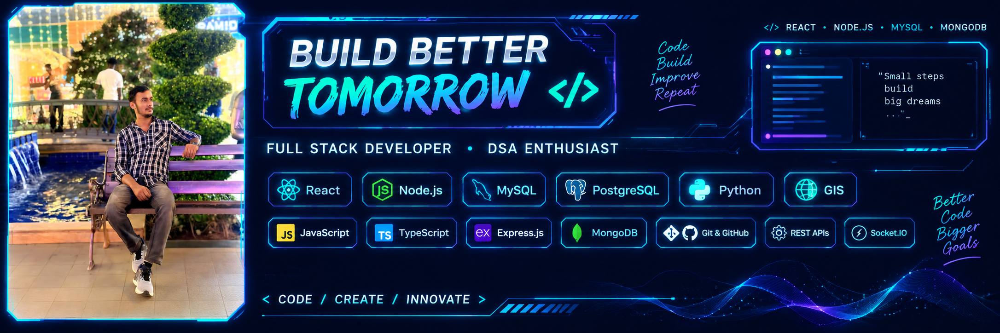

<h1 align="center">Hi 👋, I'm Bhasker Kumar Singh</h1>

<h3 align="center">Full Stack Developer · Python & GIS Developer · DSA Enthusiast</h3>

<p align="center">
  
</p>

<!-- Animated Neon Developer Workspace -->
<p align="center">
  
    alt="Animated Neon Developer Workspace"
    width="100%"
  />
</p>
---

## 🚀 About Me

- 🔭 Building a **Google Maps Navigation Simulator**
- 🗺️ Working with **GIS road networks and graph systems**
- 🌱 Learning **DSA, System Design and Scalable Backend Development**
- 🧠 Daily stack: **React, Node.js, Express, MySQL, Python, Shapely**

---

## 🛠️ Tech Stack

<p align="center">
  
</p>

<p align="center">
  
  
  
  
</p>

---

## 🌟 Featured Project: Google Maps Navigation Simulator

A Google Maps-inspired system for real-world route planning and graph algorithms.

**Features:** location search · interactive map · road network graph · shortest path · traffic simulation · alternate routes · nearby places · vehicle tracking · route analytics

```text
Frontend    → React + Vite + Leaflet
Backend     → Node.js + Express
Database    → MySQL
GIS         → Python + Shapely + Pyogrio + OpenStreetMap
Algorithms  → Dijkstra · A* · BFS · DFS
```

---

## 📊 GitHub Stats (live)

<p align="center">
  
  
</p>

<p align="center">
  
</p>

<p align="center">
  
</p>

---

## 🤝 Connect

<p align="center">
  <a href="https://github.com/bhaskerkumarsingh7327">
    
  </a>
</p>

<p align="center"><i>"First, solve the problem. Then, write the code."</i></p>
